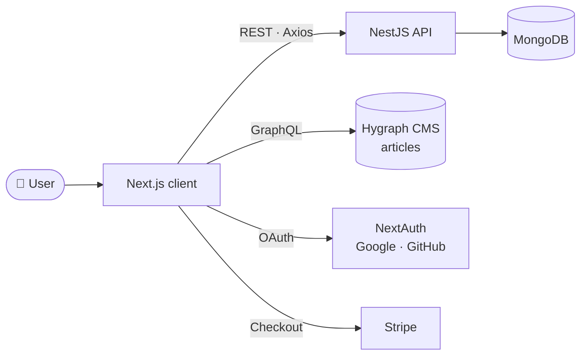

<div align="center">

# 🎓 Edu Platform

**An online learning platform where students learn, instructors teach and earn, and admins keep it all running.**


[✨ Features](#-features) •
[🧰 Tech stack](#-tech-stack) •
[🚀 Getting started](#-getting-started) •
[🗂️ Structure](#️-project-structure) •
[🧭 Routes](#-routes) •
[🏗️ Architecture](#️-architecture)

</div>

---

## ✨ Features

> Click a role to see what it can do.

<details open>
<summary><b>👩‍🎓 Students</b></summary>
<br>

- 🔎 Browse, search and enroll in courses
- 📺 Learning dashboard with lessons and progress tracking (complete / uncomplete)
- ⭐ Leave reviews with star ratings
- 🛒 Cart, 💳 Stripe checkout and 🏷️ coupons
- 📦 Subscription plans with a free trial
- 📚 Books shop and 📰 blog articles

</details>

<details>
<summary><b>👨‍🏫 Instructors</b></summary>
<br>

- 📝 Apply to become an instructor
- 🧱 Create and edit courses, build the curriculum (sections and lessons) with a rich-text editor
- 💾 Save drafts and publish when ready
- 👥 See enrolled students
- 📈 Track revenue with charts and check the balance

</details>

<details>
<summary><b>🛡️ Admins</b></summary>
<br>

- 👤 Manage users
- 🧑‍🏫 Approve and manage instructors
- 🎬 Manage courses
- 📖 Manage books

</details>

<details>
<summary><b>🌍 Everyone</b></summary>
<br>

- 🔐 Email/password login with email verification and account recovery
- 🟢 Social login with Google and GitHub
- 🌐 4 languages: 🇬🇧 English · 🇺🇿 Uzbek · 🇷🇺 Russian · 🇹🇷 Turkish
- 🌗 Light and dark mode

</details>

---

## 🧰 Tech stack

| Area | Tools |
| --- | --- |
| ⚛️ Framework | Next.js 13 (Pages Router), React 18, TypeScript |
| 🎨 UI | Chakra UI, Emotion, Framer Motion, React Icons |
| 🗃️ State | Redux Toolkit, React Redux |
| 📋 Forms | Formik, Yup |
| 🔌 Data | Axios, GraphQL Request (Hygraph CMS for articles) |
| 🔐 Auth | NextAuth, JWT cookies |
| 💳 Payments | Stripe |
| 🌐 i18n | i18next, react-i18next |
| 📊 Charts | Chart.js, react-chartjs-2 |

---

## 🏗️ Architecture



---

## 🚀 Getting started

### 1️⃣ Prerequisites

- [Node.js](https://nodejs.org/) 18 or newer
- The backend API running (the `backend` NestJS project, default port `8000`)

### 2️⃣ Clone and install

```bash
git clone https://github.com/dilshodbek-swe/edu-platform.git
cd edu-platform
npm install
```

### 3️⃣ Add environment variables

<details>
<summary>📄 Click to see the <code>.env</code> template</summary>
<br>

Create a `.env` file in the project root:

```env
# Backend API (without /api at the end)
NEXT_PUBLIC_API_SERVICE=http://localhost:8000

# Hygraph CMS (articles)
NEXT_PUBLIC_HYGRAPH_ENDPOINT=

# NextAuth
NEXTAUTH_URL=http://localhost:3000
NEXTAUTH_JWT_SECRET=
NEXT_PUBLIC_SECRET_AUTH=

# OAuth providers
GOOGLE_CLIENT_ID=
GOOGLE_CLIENT_SECRET=
GITHUB_CLIENT_ID=
GITHUB_CLIENT_SECRET=

# Stripe
NEXT_PUBLIC_STRIPE_PUBLISHABLE_KEY=
```

</details>

### 4️⃣ Run it

```bash
npm run dev
```

🎉 Open **[http://localhost:3000](http://localhost:3000)** and you're in.

<details>
<summary>📜 All scripts</summary>
<br>

| Command | What it does |
| --- | --- |
| `npm run dev` | Start the development server |
| `npm run build` | Build for production |
| `npm run start` | Run the production build |
| `npm run lint` | Run ESLint |

</details>

---

## 🗂️ Project structure

<details>
<summary>📁 Click to expand the folder tree</summary>
<br>

```
src/
├── api/             # Axios instance with auth interceptors
├── components/      # Reusable UI components
├── config/          # API routes, theme, site and editor config
├── helpers/         # Small utility functions
├── hooks/           # Custom hooks (useAuth, useActions, ...)
├── i18n/            # i18next setup
├── icons/           # SVG icon components
├── interfaces/      # TypeScript types
├── layouts/         # Layouts: header, footer, sidebar, SEO, instructor, admin
├── page-component/  # Page-level components
├── pages/           # Next.js routes
├── provider/        # App providers
├── services/        # API calls grouped by domain
├── store/           # Redux slices
├── styles/          # Global styles
└── validations/     # Yup schemas
public/
├── images/
└── locales/         # Translations: en, uz, ru, tr
```

</details>

---

## 🧭 Routes

<details>
<summary>🌐 Public pages</summary>
<br>

| Route | Page |
| --- | --- |
| `/` | Home |
| `/courses` | All courses |
| `/courses/[slug]` | Course details |
| `/articles` · `/articles/[slug]` | Blog |
| `/books` | Books shop |
| `/pricing` | Subscription plans |
| `/about` · `/contact` · `/faq` | Info pages |
| `/auth` | Login and register |

</details>

<details>
<summary>👩‍🎓 Student pages</summary>
<br>

| Route | Page |
| --- | --- |
| `/courses/dashboard/[slug]` | Learning dashboard |
| `/shop/cart` | Cart |
| `/shop/checkout` | Checkout |
| `/shop/success` | Payment success |
| `/become-instructor` | Instructor sign-up |

</details>

<details>
<summary>👨‍🏫 Instructor panel</summary>
<br>

| Route | Page |
| --- | --- |
| `/instructor` | Overview |
| `/instructor/courses` | My courses |
| `/instructor/create-course` | New course |
| `/instructor/edit-courses/...` | Edit a course |
| `/instructor/curriculum/...` | Sections and lessons |
| `/instructor/draft-courses` | Drafts |
| `/instructor/students` | Students |
| `/instructor/revenue` | Revenue |

</details>

<details>
<summary>🛡️ Admin panel</summary>
<br>

| Route | Page |
| --- | --- |
| `/admin/users` | Users |
| `/admin/instructors` | Instructors |
| `/admin/courses` | Courses |
| `/admin/books` | Books |

</details>

---

<div align="center">

⭐ **If you like this project, give it a star!** ⭐

Made with ❤️ by [dilshodbek-swe](https://github.com/dilshodbek-swe)

</div>
